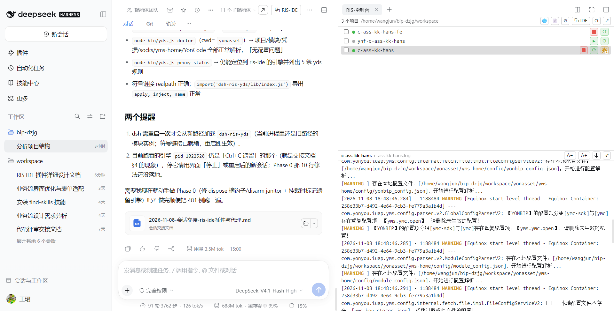
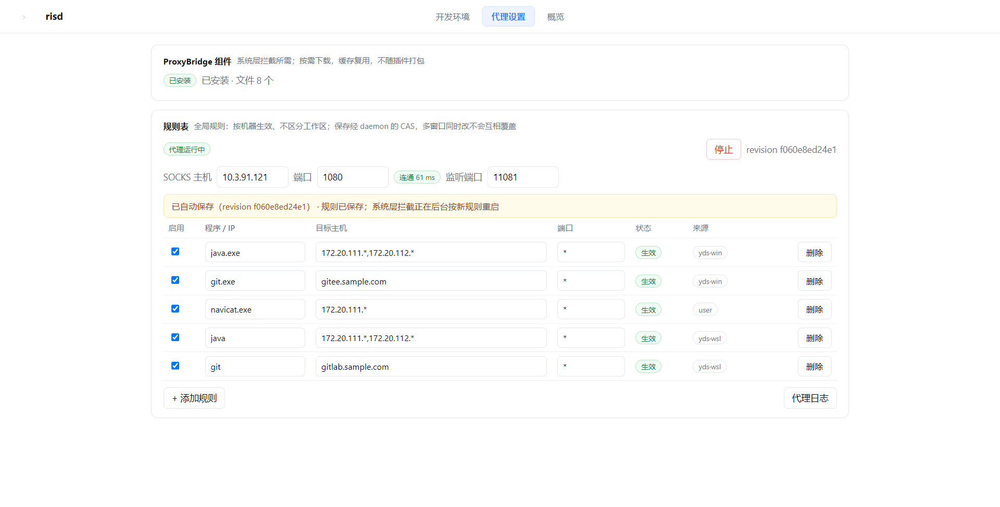

# dsh-ris-yds

YonBIP YDS 客开后端的本地运行时，做成 **DSH 插件 + CLI** 双形态：

- **DSH 插件**：给 coding agent 提供一整套 `yds_*` 工具（体检 / 配置 / 凭据 / 运行时 / 集成 / 调试）。
- **CLI**（`bin/yds.js`，装包后 `yds` 命令）：同一套能力给人用（在终端或 IDE 里执行）。

在本地把后端运行时跑起来，用本地实例替代远端环境做开发联调。

## 截图

| 在 DSH 里管理本地服务：启停、实时日志、调试入口 |
|---|
|  |

| 内网访问规则（可选）：按程序 / 内网地址 / 端口放行，一次启用 |
|---|
|  |

## 能做什么

- **本地运行**：构建、启动、停止、查看状态与实时日志；启动失败自动回收，不留下半启动的进程。
- **平台配置**：从平台拉取配置并适配到本地运行时；支持离线缓存，网络不可达时也能启动。
- **内网访问**：数据库 / 缓存 / 内网服务可经代理或直连访问；本机其它客户端也能共用同一条隧道。dsh-ris-ide 的代理 daemon（risd）在跑时自动共用它的引擎，`yds stop` 只撤自己的规则、不打断别人
  （需要系统权限的可选能力）。
- **平台凭据**：生成调用平台 API 的 YYCToken，新环境无需额外安装。
- **前端调试**：让远端页面加载本地前端资源。内置一个极简 MV3 扩展（`yds fe extension` 一键生成目录，浏览器里加载一次）：它给本模块的请求带上 `rdbga`、把远端 `extend*.min.js|css` 换成 `127.0.0.1:<dev端口>/static`，所有值由扩展向本机 `yds` 动态拉取，跟随项目和插件升级；不装扩展时用 `yds fe plan`（CDP 注入）或 `yds fe url <page>`（`scriptUrl`）。
- **IDE 面板**：在 dsh-ris-ide 面板里启停本地服务、查看实时日志、做 JDWP 断点调试。
- **外部 IDE**：本地运行时可被外部 IDE 直接 F5 启动调试。
- **浏览器回调校准**：确保工作台页面的请求回落到本机实例（失败时是静默的，自检可查）。
- **专用调试浏览器**：`yds browser debug` 用独立 profile 起一个 Chrome/Edge，启动即加载 `ris-yds-extension`（**自动加载，无需手工安装，也不用在 IDE 概览里加插件条目**）并开
  `--remote-debugging-port`——不用手工装扩展，也不碰日常浏览器；`yds browser stop` 只停它自己启动的实例。
- **环境自检**：`yds doctor` 一次列出配置、运行时、端口、隧道等所有缺失项。

## 安装

```bash
# 公开 npm（推荐）
dsh plugin --profile web add dsh-ris-yds

# 或从本地 checkout 安装（开发调试）
dsh plugin --profile web add <本目录>
```

装完需**重启 `dsh web`**（宿主插件只在启动时组合一次，工具注册才生效）。新会话里 agent 就有
`yds_*` 工具；`skills/dsh-ris-yds` 会自动同步到项目 `.dsh/skills`。

前置：JDK 21 与 Maven 在 `PATH`（或在 `.env` 指定 `java.path` / `maven.settings`）。

## 快速开始

```bash
cd <你的 YonBIP 项目目录>

yds doctor          # 体检：配置解析、运行时、端口、隧道/缺失项
yds confcenter      # 拉取并适配平台配置（首次联网；之后可 --offline）
yds build           # 首次构建运行时（下载依赖，约 19 分钟；缓存后约 1 分钟）
yds start           # 后台启动（幂等；缺少配置/隧道会自动补；已在运行时返回 alreadyRunning）
yds start --restart # 重启：先停掉现有实例（含 pidfile 丢失、按端口识别到的实例）再启动
yds status          # 进程、端口、就绪状态
yds logs --lines 200
yds stop
```

## 命令一览

| 命令 | 能力 |
|---|---|
| `yds doctor` / `yds config` / `yds token <url>` | 体检 / 生效配置（凭据打码）/ 生成平台 API 凭据 |
| `yds confcenter [--offline]` | 拉取并适配平台配置到本地运行时 |
| `yds build` | 构建本地运行时（首次下载依赖） |
| `yds start [--restart]` / `yds stop [--keep-socks]` / `yds status` / `yds logs` | 本地运行时生命周期（启动幂等、按端口接管丢失 pidfile 的实例、`--restart` 先停后起） |
| `yds ide apply\|check\|remove` | 本地运行时的 IDE 面板集成（启停 / 日志 / 调试） |
| `yds proxy [status\|sync\|start\|stop\|git-on\|git-off]` | 内网访问与 git 代理 |
| `yds browser [status\|fix] [--dry-run]` | 浏览器请求回调校准 |
| `yds browser debug [--url=<页面>] [--port=<9222>]` / `yds browser stop` | 用独立 profile 启动/停止带扩展的调试浏览器（自动装 `ris-yds-extension`、开 CDP，不影响日常浏览器；优先用真实 Chrome/Edge，不用 Playwright 的 Chrome for Testing——后者窗口顶部有 "Download Chrome" 横幅；界面语言默认简体中文（`LANGUAGE=zh_CN`，`YDS_BROWSER_LANG` 覆盖）；关闭时会快照登录 cookie，下次启动自动恢复） |
| `yds fe [extension\|plan\|url <page>]` | 前端调试接入（生成扩展目录 / CDP 请求改路 / URL 参数） |

## 配置（`.env` / 环境变量）

> `.env` 是工作区根的机器级配置（可选，与 dsh-ris-ide 共用）。**确认是 yds 项目后**（工作区里找到含
> `yds.*` 键的 `.vscode/settings.json`；其它目录一律不动），**任何 yds 命令加载配置时**都会检查它：
> 文件不存在或缺 `git.url` / `socks.host` / `socks.port` / `proxy.javaRules` 时，自动补上对应的
> **注释占位**（`#git.url=` …，追加不覆盖，已有值/已有注释行都不动），所以新机器不用猜键名，直接填值即可。
> 占位还没填值时会输出 `[yds] 待补齐配置（未生效）: …`，提示（agent）向用户确认后把 `#key=` 改成 `key=<值>`；
> 本机确实不需要这些配置时，在 `.env` 追加一行 `# yds: 配置已确认（无需补齐）` 即可停止提醒。


工作区根目录放一份 `.env` 即可，键名不带插件前缀；项目 `.vscode/settings.json` 的 `yds.*` 优先。

| 键 | 默认 | 说明 |
|---|---|---|
| `socks.host` / `socks.port` | 空 | 都空 = 直连；有值 = 代理模式 |
| `socks.dbPort` / `socks.redisPort` | 1521 / 6890 | 本机映射端口（JDBC/Redis 客户端用） |
| `ide.launch` | `proxy` | `proxy` / `direct`：外部 IDE 走代理还是直连 |
| `git.proxy` | `auto` | `off` 关闭 git 代理 |
| `local.ymsHome` | `<项目>/yms-home` | 本地运行时目录 |
| `maven.settings` / `maven.repo` | 空 | 构建用；留空用默认设置 |
| `java.path` | 空 | 指定 JDK（留空用 PATH） |

## 两种使用方式：代理 / 直连

| | 代理模式（有 `socks.*`） | 直连模式（无 `socks.*`） |
|---|---|---|
| 内网访问 | 经隧道；本机端口映射给 JDBC/Redis | 直接访问，不起任何隧道 |
| 本地运行时配置 | 改写成 `127.0.0.1` 映射地址 | 平台地址原样保留 |
| git 代理 | 自动按克隆地址主机写入 | 不写 |

### 隧道从哪来（自动选择，无需配置）

1. **dsh-ris-ide 的 risd daemon 在跑**：规则、租约与系统层拦截交给它（写规则 + 登记租约），
   daemon 的引擎不另起；但 YMS 配置被改写成 `127.0.0.1:<dbForwardPort>/<redisForwardPort>`，
   而 daemon 引擎的 127.0.0.1 映射只做同端口映射，覆盖不到这两个端口，所以**内置 SOCKS 转发器
   仍会作为兜底 127.0.0.1 映射同时启动**（代理模式下是两个进程：daemon 引擎 + 内置转发器；
   直连模式下都不起）；
2. 装了 dsh-ris-ide 但 daemon 没跑：借用它已有的代理引擎（127.0.0.1 映射由它按规则提供）；
3. 都没有：用本插件内置的 SOCKS 转发器（零依赖，不需要 dsh-ris-ide）。

规则表是**全局一张表**（面板/文件只有一份，保存即整表覆盖，不区分 workspace）。yds 每次启动注入自己
那一段时是「保留非 yds 行 + 用本次的 yds 行整体替换旧的 yds 行」，所以 `yds stop` 会把表里**全部** yds 行
撤掉（同一台机器上的多个项目共用这张表，没有交叉配置）；非 yds 行（你自己加的规则、其它工具注入的）不受影响。
非 Windows（含 WSL）除了 `java.exe`/`git.exe` 还会注入本地侧 `java`/`git` 两条规则（`side` 标明侧别），
WSL 里的 JVM/git 才会被拦截。`yds stop` **不会主动停掉机器级引擎**（IDE 可能还在用）。
输出里的「已从共享规则表移除 N 条规则/M 个 host」是本次真正减掉的部分，减掉 0 时会明确说没改动规则表。
注意 `yds stop` 释放的是本项目的租约：如果 daemon 的生命周期配置是「无租约即拆除代理」，而 yds 恰好是
最后一个租约持有者，daemon 会在约 300ms 后自己关闭隧道（这不是 yds 去停它，进程日志里会打出来）。

同一台机器可以混合：dsh 走代理、外部 IDE 直连（`.env` 里设 `ide.launch=direct`）：

```bash
# .env: 保留 socks.host / socks.port，加 ide.launch=direct
yds confcenter   # 准备运行配置
yds ide apply    # 应用当前模式
```

切换模式只需改 `ide.launch` 后重新应用。

## 与 dsh-ris-ide 搭配（可选）

装上 [`dsh-ris-ide`](https://gitee.com/riscloud/dsh-ris-ide) 后，可在同一个 dsh 里获得：

- 启停本地服务、查看实时日志（只看本次启动）；
- JDWP 断点调试（线程、调用栈、变量）；
- 工作区文件树、编辑器、搜索与多文件粘贴。

两者**互不依赖**，可各自单独安装：没装 dsh-ris-ide 时本插件各项能力照常可用。

## 安全与边界（摘要）

- `workbenchUrl` 是**项目级信任根**：只对可信仓库执行 `yds build` / `yds start`。
- 本机转发端口无鉴权（单用户开发机可接受）。
- `yds token` 明文输出短期凭据，避免落盘。
- 涉及浏览器状态的命令支持 `--dry-run` 预览，不确定时先预览。

完整清单与实现理由见 [DEVELOPMENT.md](DEVELOPMENT.md) §15。

## 开发

- 架构、模块、内部机制（配置管线、隧道、模式隔离、IDE 集成、校准、发版）见
  **[DEVELOPMENT.md](DEVELOPMENT.md)**。
- 测试与自检：

  ```bash
  npm test               # node --test "test/*.test.mjs"
  npm run check:listing  # 上架自检（❌ 必须为 0）
  ```

- 目录：`lib/` 实现、`bin/` CLI、`native/` 原生凭据模块（6 平台）、`assets/` 浏览器扩展包、
  `test/` 测试、`skills/` dsh 技能。

## License

MIT
